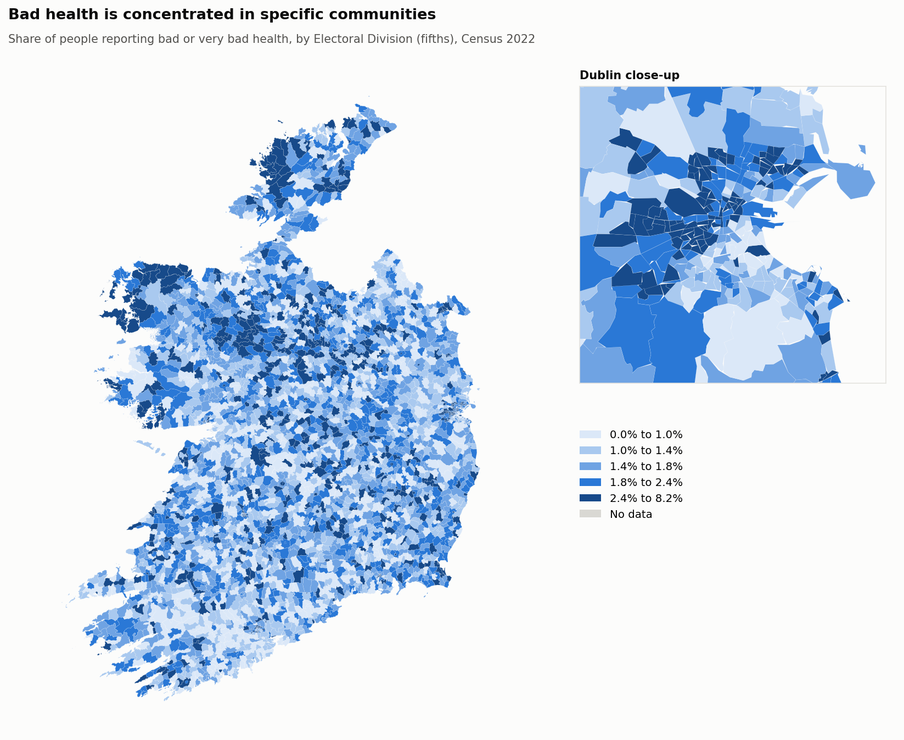

# Health and Deprivation Across Ireland's Communities

Where is bad health concentrated in Ireland, and what is it linked to? An automated, reproducible
analysis of **Census 2022** for all **3,420 Electoral Divisions**, written for policymakers.

**[Read the report →](https://bymankirat.github.io/ireland-census-health/)**



> Independent analysis of CSO data. Not an official CSO publication. Findings describe areas, not
> individuals, and are associations, not causes.

## What it does

1. **Downloads** five Census 2022 tables (general health, age, education, economic status, housing tenure)
   for every Electoral Division from the CSO's open data API, plus ED boundaries from Tailte Éireann.
2. **Checks data quality first:** 13 automatic checks (coverage, matching EDs across tables, categories
   adding to totals, missing or impossible values, non-response, small areas, map matching) written to
   `reports/qc_log.txt`. Any failure stops the run.
3. **Measures association properly:** population-weighted regression with robust (HC1) 95% confidence
   intervals and variance inflation factors, separating age from social factors.
4. **Tests prediction honestly:** linear model vs random forest, validated on **whole counties held out**
   (grouped cross-validation), so neighbouring areas cannot leak into the test.
5. **Profiles communities** with k-means (k chosen by silhouette), using social indicators only, then
   compares their health.
6. **Flags areas with more ill-health than their age profile predicts**, a transparent shortlist for local attention.
7. **Publishes** maps, charts and a plain-English report to `docs/index.html` (GitHub Pages).

## Statistical choices worth noting

- **Areas, not people:** the ecological fallacy is stated up front.
- **Reverse causation:** "unable to work due to illness or disability" is deliberately excluded as a
  predictor because it partly measures the outcome.
- **Small areas are noisy:** every model is weighted by population; small EDs are flagged in QC.
- **Collinearity:** only one education measure enters the regression, and VIFs are reported.

## Run it

```bash
pip install -r requirements.txt
python run_pipeline.py          # downloads everything (first run 1-2 minutes)
```

## Structure

```
run_pipeline.py      download -> QC -> statistics -> maps -> report
src/data.py          CSO PxStat + boundary download, indicators per ED
src/quality.py       automatic quality checks and log
src/stats.py         weighted regression, grouped CV, random forest, k-means, age-expected gap
src/charts.py        maps (with Dublin close-up) and charts
src/report.py        policy-facing web report
```

Contains CSO and Tailte Éireann data, licensed under CC BY 4.0. Mankirat Singh ·
[Portfolio](https://bymankirat.github.io/myportfolio/) · [LinkedIn](https://linkedin.com/in/mankirat-singh-694440177)
